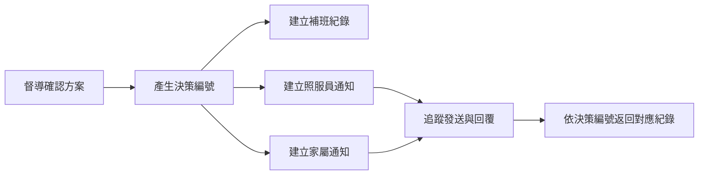

# CareRescue 居服異動與量能救援平台

CareRescue 是為居家照護督導設計的服務異動處理與補班決策平台。系統將照服員請假、受影響班次、候選人篩選、替補方案比較、通知追蹤、決策留痕與量能分析整合在同一套操作流程中，協助督導快速掌握服務缺口並完成補位。

本專案以可操作的前端展示環境呈現完整流程，所有關鍵操作會同步更新頁面資料，適合用於企業導師評估、情境展示與流程驗證。

## 專案目標

居家照護臨時異動常涉及多項條件：照服員是否有空、服務時間與交通是否衝突、個案是否有性別或技能需求、替補人員的工作量，以及通知是否成功送達。若資訊分散，督導需要花費大量時間逐一確認。

CareRescue 將這些工作整合成一條可追蹤的處理流程：

- 從照服員請假建立服務異動。
- 自動辨識受影響班次並列入待處理清單。
- 依必要條件排除不適合的候選人。
- 比較多組補班方案及其代價與風險。
- 保存督導的選擇、操作人與決策原因。
- 追蹤照服員及個案家屬的通知狀態。
- 將處理結果回饋至總覽、紀錄與量能分析。

## 使用角色

### 督導

使用網頁版管理今日服務、審核請假、處理異動、比較補班方案、進行人工選派、追蹤通知、查閱紀錄，以及維護人員與班次資料。

### 照服員

使用手機版請假頁面查看當日班次、填寫請假資料、確認受影響服務，並追蹤申請狀態。

## 完整作業流程


側邊選單依實際操作順序排列，讓使用者可由上而下完成作業：

1. 今日總覽
2. 請假申請
3. 請假審核
4. 異動事件
5. 補救方案
6. 通知與追蹤
7. 補班紀錄
8. 量能分析
9. 人員與班表
10. 系統設定

## 已完成的功能

### 今日總覽

- 彙整今日待處理、服務狀態與重要提醒。
- 顯示受影響班次、照服員量能與事件原因。
- 以服務時間軸呈現班次及異動節點。
- 從待處理項目直接進入補救方案。
- 右上角通知中心可快速查看最新狀態，點擊頁面其他位置即可收合。

### 請假申請與情境模擬

- 網頁版請假表單支援照服員、假別、日期、開始時間、結束時間、原因及緊急狀態。
- 可使用預設情境快速示範臨時病假、家庭照顧假與事假。
- 可自訂請假模擬情境，包含人員、日期、假別、時段、原因及緊急狀態。
- 送出前會顯示受影響班次數量，方便確認異動範圍。
- 可從網頁版直接開啟手機請假頁面進行展示。

### 手機請假頁面

- 針對照服員手機操作設計的獨立介面。
- 顯示使用者與當日服務班次。
- 支援完整請假資料填寫及送出。
- 即時預覽請假時段影響的服務。
- 顯示請假申請紀錄與審核狀態。
- 手機版與督導端共用資料，送出後可在審核頁查看。

### 請假審核

- 將申請與審核分成不同頁面，符合角色與權限分工。
- 顯示申請人、假別、時段、原因及受影響班次。
- 支援核准與退回處理。
- 核准後將異動納入後續服務缺口流程。

### 異動事件

- 建立請假、延誤、停服、送醫與需求變更等事件。
- 選擇受影響照服員並填寫原因或變更內容。
- 顯示事件紀錄及受影響服務，作為補救流程的來源。
- 以明確提示說明各類事件對服務的影響。

### 補救方案與決策支援

- 依風險及服務時間顯示待處理班次。
- 以低、中、高風險區分候選方案。
- 比較新增交通時間、主要代價、後續風險與綜合評估。
- 方案卡片使用一致的藍、黃、橘配色，方便快速辨識。
- 提供接受方案、調整方案與拒絕方案等決策操作。
- 保存操作人與決策原因，形成可查核紀錄。
- 支援人工指定照服員，並在確認前檢查必要條件。

### 候選人篩選與排序

系統先檢查不可違反的必要條件，再比較可接受方案的整體代價。

必要條件包含：

- 照服員在該時段是否可用。
- 個案性別需求是否符合。
- 必要技能是否具備。
- 工作量是否超過每日上限。
- 原班次、交通時間與新班次是否衝突。
- 服務延遲是否在可接受範圍內。

通過必要條件後，系統依下列因素協助排序：

- 是否熟悉該個案。
- 服務延遲時間。
- 新增交通時間。
- 照服員近期補班次數。
- 對其他服務與整體班表的影響。

### 通知與追蹤

- 決策完成後建立照服員與個案家屬的通知項目。
- 顯示待發送、等待回覆、已回覆及失敗等狀態。
- 支援模擬發送、收到回覆、發送失敗與重新處理。
- 以進度節點呈現「建立通知、已發送、收到回覆」。
- 可由通知項目直接開啟其對應的決策紀錄。

### 補班紀錄

- 保存每次方案選擇、操作人、原因及建立時間。
- 顯示原安排與調整後安排，便於回溯服務變更。
- 顯示相關通知對象與追蹤狀態。
- 從通知頁進入時，會自動捲動並醒目標示正確的決策紀錄。
- 通知追蹤負責聯繫進度，補班紀錄負責決策與安排留痕，兩者透過同一筆決策編號串接。

### 量能分析

- 顯示待補位、已補位、補位率及平均決策時間。
- 統計各照服員補班次數與新增服務分鐘。
- 呈現異動類型分布與照服員量能負荷。
- 顯示首選方案採用率、服務完成狀態與負荷集中度。
- 提供七日事件趨勢與區域服務缺口，協助督導掌握資源配置。

### 人員與班表

- 新增照服員基本資料、服務區域、技能、每日上限及性別條件。
- 新增服務班次並指定個案、照服員、區域與服務時段。
- 建立班次時檢查照服員時段是否重疊。
- 提供人工選派功能，供督導處理特殊情況。
- 所有操作按鈕統一靠右，維持一致的表單操作動線。

### 系統設定

- 集中呈現平台展示設定與資料管理操作。
- 維持與其他頁面一致的卡片、色彩及按鈕樣式。

### 登入與版面

- 登入成功後固定進入今日總覽。
- 登入頁不直接顯示示範帳號與密碼。
- 左側導覽固定顯示，主內容可獨立上下捲動。
- 側邊欄下方顯示目前登入角色與帳號，登出按鈕位於使用者資訊下方。
- 頁面採 CareRescue 品牌識別、圓角卡片與柔和配色，兼顧資訊辨識與親和感。

## 通知與補班紀錄的資料關係

通知與補班紀錄屬於同一流程中的不同階段：



每次決策都會產生唯一識別資料，通知項目以該資料連回原決策，因此不會將不同個案或不同補班方案混在一起。

## 快速開始

### 環境需求

- Node.js 18 以上版本
- npm

### 安裝與啟動

```bash
npm install
npm run dev
```

啟動後依終端機顯示的網址開啟系統，通常為：

```text
http://localhost:5173
```

### 展示帳號

| 欄位 | 內容 |
| --- | --- |
| 帳號 | `supervisor.demo` |
| 密碼 | `********` |
| 角色 | 督導 |

### 正式建置與預覽

```bash
npm run build
npm run preview
```

## 建議展示流程

以下流程可完整呈現平台價值：

1. 使用督導帳號登入，確認系統進入「今日總覽」。
2. 進入「請假申請」，選擇預設情境或自行輸入模擬情境。
3. 開啟手機請假頁，展示照服員查看班次、填寫請假與確認受影響服務。
4. 前往「請假審核」，核准剛建立的申請。
5. 在「異動事件」確認服務缺口已進入處理流程。
6. 前往「補救方案」，選擇一筆待處理班次。
7. 比較低、中、高風險方案的交通時間、代價與後續風險。
8. 確認方案並填寫操作人與決策原因。
9. 在「通知與追蹤」模擬發送及收到回覆。
10. 點選「查看決策紀錄」，確認系統精確定位對應紀錄。
11. 回到「今日總覽」查看狀態更新。
12. 進入「量能分析」查看補位成果與人力負荷變化。

## 頁面路由

| 頁面 | 路由 | 主要用途 |
| --- | --- | --- |
| 登入 | `/login` | 督導登入 |
| 今日總覽 | `/dashboard` | 今日服務與待辦整合 |
| 請假申請 | `/leave` | 建立請假與模擬情境 |
| 手機請假 | `/mobile/leave` | 照服員手機操作展示 |
| 請假審核 | `/leave-review` | 核准或退回請假 |
| 異動事件 | `/events` | 建立及查看服務異動 |
| 補救方案 | `/rescue` | 查看待處理班次 |
| 方案比較 | `/rescue/:shiftId` | 比較候選方案並決策 |
| 通知與追蹤 | `/notifications` | 追蹤通知發送與回覆 |
| 補班紀錄 | `/records` | 查閱決策與安排紀錄 |
| 量能分析 | `/analytics` | 查看服務與人力量能 |
| 人員與班表 | `/people` | 維護人員、班次與人工選派 |
| 系統設定 | `/settings` | 平台展示與資料管理 |

## 資料同步與保存

- 各功能頁共用同一份應用程式狀態，操作結果會同步反映至相關頁面。
- 請假、班次、決策與通知之間保留可追蹤的資料關聯。
- 展示資料會保存在瀏覽器的 `localStorage`，重新整理後仍可延續操作。
- 登出後可重新登入並繼續展示既有流程。

## 技術架構

| 類別 | 技術 |
| --- | --- |
| 前端框架 | React 19 |
| 程式語言 | TypeScript 5.7 |
| 建置工具 | Vite 6 |
| 路由 | React Router 7 |
| 樣式 | CSS Modules、全域設計變數 |
| 狀態管理 | React Context |
| 展示資料保存 | Web Storage API（localStorage） |

## 專案結構

```text
src/
├─ components/       共用元件、圖示、方案卡片與決策視窗
├─ config/           導覽與頁面設定
├─ context/          共用狀態及跨頁操作
├─ data/             展示資料與初始情境
├─ layouts/          固定側邊欄及主內容版面
├─ pages/            各功能頁面
├─ types/            TypeScript 資料型別
├─ App.tsx           路由入口
└─ main.tsx          應用程式啟動入口
```

## 開發指令

| 指令 | 用途 |
| --- | --- |
| `npm run dev` | 啟動開發環境 |
| `npm run build` | 執行 TypeScript 檢查並建立正式版本 |
| `npm run preview` | 預覽正式建置結果 |
| `npm run format` | 格式化專案檔案 |
| `npm run format:check` | 檢查程式碼格式 |

---

CareRescue 以「服務不中斷、決策可說明、流程可追蹤」為核心，讓督導能在臨時異動發生時，從發現缺口到完成補位都保有一致且清楚的操作依據。
